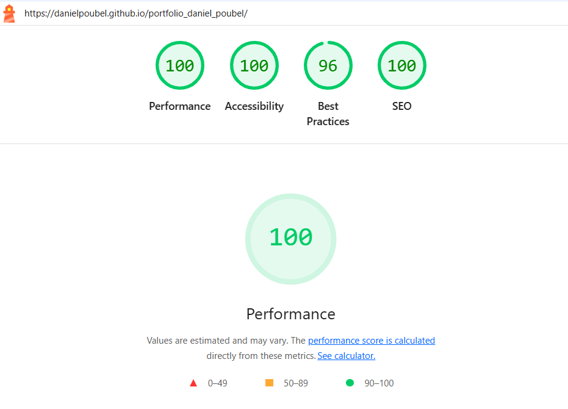

# RELATÓRIO DE TESTES — PORTFÓLIO DANIEL POUBEL

## 1. Identificação

- **Projeto:** Portfólio Profissional — Daniel Poubel
- **Responsável pelo desenvolvimento e QA:** Daniel Poubel
- **Data da revisão:** 26/11/2026
- **Ambiente:** Google Chrome e GitHub Pages

## 2. Resumo da execução

Durante o desenvolvimento do portfólio, foram realizadas verificações funcionais, visuais e técnicas. As ferramentas de desenvolvimento do navegador foram utilizadas para investigar comportamentos, inspecionar elementos e validar a apresentação da aplicação.

## 3. Ferramentas utilizadas

**Google Chrome DevTools**
- Console: investigação de erros JavaScript.
- Elements: inspeção da estrutura HTML e dos estilos CSS.
- Device Toolbar: simulação de diferentes dimensões de tela.

**Google Lighthouse**
- Avaliação de desempenho.
- Avaliação de acessibilidade.
- Avaliação de SEO.
- Verificação de boas práticas.

**Git e GitHub**
- Versionamento do código.
- Registro das alterações.
- Publicação pelo GitHub Pages.

## 4. Resultados Lighthouse

| Indicador | Pontuação |
|---|---:|
| Performance | 99 |
| Acessibilidade | 100 |
| SEO | 100 |

Pontuações registradas durante a avaliação do projeto.

## 5. Defeitos identificados e correções

### DEF-001 — Dimensionamento da logo principal

**Problema:** A logo da página inicial apresentava dimensão diferente das demais páginas.

**Causa:** A estrutura HTML não correspondia ao seletor CSS responsável pelo dimensionamento.

**Correção:** Ajuste da estrutura do elemento no cabeçalho.

**Reteste:** Exibição conferida no navegador.

**Resultado:** Corrigido.

### DEF-002 — Alternância da logo conforme o tema

**Problema:** A logo da página Minha Trajetória não alternava conforme o tema selecionado.

**Investigação:** Revisão do HTML, dos identificadores dos elementos e do carregamento do script de tema.

**Correção:** Ajustes na estrutura e nos caminhos dos elementos envolvidos.

**Reteste:** Funcionamento confirmado posteriormente no navegador.

**Resultado:** Corrigido e aprovado no reteste.

## 6. Verificações de segurança

Foram considerados cuidados básicos durante o desenvolvimento:

- Não disponibilizar credenciais ou tokens no repositório.
- Manter a organização dos arquivos e scripts.
- Evitar exposição desnecessária de informações sensíveis.

Não foi realizada auditoria especializada, análise formal de vulnerabilidades ou teste de invasão.

## 7. Publicação

O projeto foi publicado utilizando GitHub Pages.

O processo contemplou desenvolvimento local, versionamento com Git, envio das alterações ao GitHub e conferência da versão publicada no navegador.

## 8. Conclusão

As correções identificadas durante a revisão foram aplicadas e verificadas no navegador.

Os resultados Lighthouse registrados demonstram bons indicadores de desempenho, acessibilidade e SEO.

**Status da revisão:** QA aprovado para o escopo de testes executado e documentado.

### Lighthouse — Desktop

Relatório de auditoria realizado com Google Chrome Lighthouse.

.